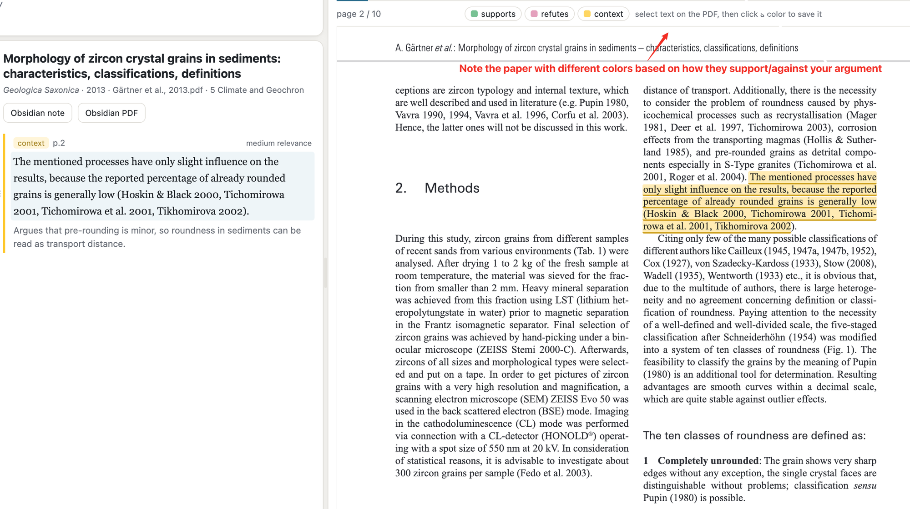
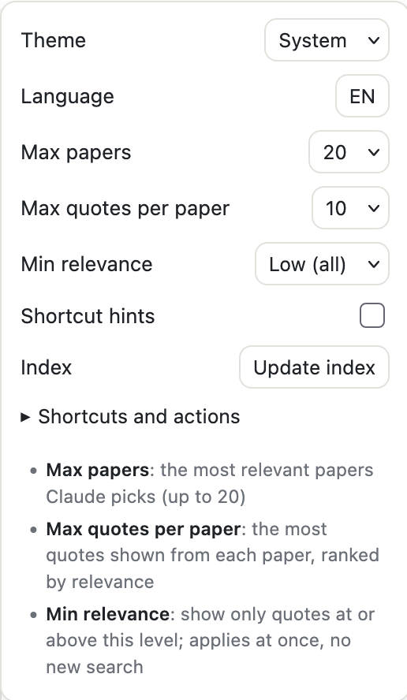

<div align="center">


# QuoteSight

**See the real sentence that backs up your claim**

For researchers with a folder full of papers and an argument that is still taking shape.


[](LICENSE)

**English** · [中文](README.zh.md)

[Before you start](#before-you-start) · [Install](#install) · [Use](#use) · [How it works](#how-it-works) · [Size and speed](#size-and-speed) · [Privacy](#data-and-privacy)

</div>

You have hundreds of papers on your computer, and you are writing the introduction or discussion of a paper. You know roughly what you want to argue, but not which paper says it, let alone which paragraph or sentence. Keyword search often misses it because the paper puts it in other words, and opening PDFs one by one can take hours.

QuoteSight first indexes the PDFs on your computer by keyword and by meaning. An AI agent you already use (Claude Code or Codex) can then search them with your half-formed argument and pick out the sentences that support or refute it. Each quote opens on its PDF page with the sentence highlighted, so you can check it against the original.

https://github.com/user-attachments/assets/5e7a2aed-259a-4060-b3ab-354cf21326fa

- **Start from a vague idea**: write the argument the way you would say it, and the agent turns it into a few precise searches.
- **Spend fewer tokens**: because your library is indexed first, the agent reads only the few dozen most relevant passages instead of whole PDFs. A full search often costs fewer tokens than having the agent read one long paper.
- **Check every quote**: QuoteSight matches each quote against the PDF text. A quote it cannot find anywhere is dropped, and a close but imperfect match is marked *unverified*.
- **Keep your files local**: the index stays on your computer, and your PDFs are only read, never changed. Only precise search sends your argument and the selected passages to Anthropic or OpenAI.
- **Simple setup**: run one installer, answer four questions, then double-click *Start*.

## Before you start

The installer asks four questions. Decide these first:

| Question | Options | If unsure |
|---|---|---|
| **1. Your system** | macOS or Windows | detected automatically |
| **2. Your coding agent** for the precise search | Claude Code, Codex, or none | the one you already use. With none, the quick search still works |
| **3. Where your PDFs are** | any folder, including its subfolders | the folder you already keep papers in |
| **4. Where to keep the index** | any folder | the default (`data` inside the QuoteSight folder). Avoid the PDF folder and cloud-synced folders |

Plan on about 3 GB of free disk space (Python packages and the embedding model) and roughly 30 MB per 100 papers for the index.

## Install

### macOS

1. **Python 3.10 or newer.** In Terminal, `python3 --version` shows the version. If it is older or missing, install Python from [python.org](https://www.python.org/downloads/) (or run `brew install python`).
2. **Get QuoteSight.** In Terminal:
   ```sh
   git clone https://github.com/ZJ-Gao/QuoteSight.git
   cd QuoteSight
   ```
   Or download the ZIP from the green *Code* button on GitHub, unzip it, and `cd` into the folder.
3. **Run the installer** and answer the four questions:
   ```sh
   ./scripts/install.sh
   ```
4. **Start**: double-click `Start.command` in the QuoteSight folder. The first run downloads the embedding model (about 550 MB) and indexes your PDFs before the board opens in your browser. Later runs only index new or changed PDFs.

> [!TIP]
> If macOS blocks `Start.command` the first time, right-click it, choose *Open*, then *Open* again.

### Windows

1. **Python 3.10 or newer.** Install it from [python.org](https://www.python.org/downloads/windows/) and tick *Add python.exe to PATH* in the installer.
2. **Get QuoteSight.** Download the ZIP from the green *Code* button on GitHub and unzip it, or with Git:
   ```powershell
   git clone https://github.com/ZJ-Gao/QuoteSight.git
   cd QuoteSight
   ```
3. **Run the installer** in PowerShell from the QuoteSight folder and answer the four questions:
   ```powershell
   powershell -ExecutionPolicy Bypass -File scripts\install.ps1
   ```
4. **Start**: double-click `Start.bat`. The first run downloads the embedding model and indexes your PDFs before the board opens in your browser.

> [!TIP]
> With an NVIDIA graphics card, indexing is much faster if you install the CUDA build of PyTorch before step 3 ([pytorch.org](https://pytorch.org/get-started/locally/)). Without one, indexing runs on the processor, which is slower but works.

### Coding agent (optional)

For the precise search, install one of these and log in once from a terminal:
- **Claude Code**: [docs.anthropic.com/claude-code](https://docs.anthropic.com/en/docs/claude-code), then run `claude` once to log in.
- **Codex CLI**: [github.com/openai/codex](https://github.com/openai/codex), then run `codex` once to log in.

QuoteSight uses your existing login or subscription, so you need no API key.

To use another provider instead (for example Gemini, a local model through Ollama, or an API key), paste [`prompts/add_model.md`](prompts/add_model.md) into your coding agent. It adds the new backend and tests it. To switch between Claude or Codex models, change `claude_model` or `codex_model` in the settings instead.

### Let your agent install it

Prefer not to use the terminal yourself? Open Claude Code or Codex in the QuoteSight folder and paste [`prompts/setup_with_ai.md`](prompts/setup_with_ai.md). The agent asks before each step as it installs QuoteSight, goes through the setup questions with you, and builds and tests the index.

## Use

### The board

Double-click *Start* (or run `quotesight-app`), type a claim or a topic, and press Enter. The board has three columns: the papers on the left, the quotes of the selected paper in the middle, and the PDF page with the quote highlighted on the right. The top bar shows the model and the tokens this search used. With Claude, it also shows how much of your 5-hour and 7-day usage is left.

Choose the search mode at the top:
- **Claude** or **Codex**: precise, about one to two minutes per search.
- **Quick**: no agent, one to two seconds and no tokens. The embedding model marks the most relevant sentences instead of the agent.

### Find the evidence for an argument

Type the argument as you would say it, for example "zircon morphology records transport distance". The agent searches your library from several angles. If the first round finds fewer papers than your limit, it runs a second round with new wording and then stops. It does not pad the list. If only twelve papers bear on the argument, you get twelve.

Each paper on the left shows how its quotes bear on your argument (*supports*, *refutes* or *context*), together with a relevance score out of 10. The score averages how well the whole paper matches your argument and how relevant the agent judged its quotes (see Score and ranking under How it works). Click a paper to read its quotes in the middle, and click a quote to see it highlighted on the PDF. Every quote is checked against the original text. A quote that cannot be found there is removed, and a close but imperfect match is marked *unverified*.



### When a paper you expected is missing, or too low

- **More related papers** (bottom of the left column) lists the next papers in the search ranking and uses no tokens. Choose **Add to results** on one and the agent reads the whole paper, picks its relevant quotes and labels each as supports, refutes or context. Papers added this way stay in that search's history.
- **Read more quotes** (middle column) asks the agent for more quotes from the open paper. Enter a number, or leave it empty and the agent decides how many.
- **★ More important than ranked** tells the board that this paper matters more than its position suggests. The agent reads more quotes from it and the ranking is recalculated. Papers similar to the ones you marked move up, and a green or red arrow on each card shows how far it moved. Marking a paper never puts it on top by itself.

### Mark your own highlights

Select text on the PDF page, then click *supports*, *refutes* or *context* in the bar above the PDF (or in the menu at the selection). The highlight is saved in that color, so you can mark passages by how they bear on your argument and find them again later. With nothing selected, click a color to change that color and its opacity. Highlights also work on accepted manuscripts, where line numbers run through the text.

### Settings and history

The gear (top left) opens the settings panel.



**Max papers** and **Max quotes per paper** limit how many papers a search returns and how many quotes each paper shows. **Min relevance** hides quotes below the level you choose, with no new search. **Language** switches between English and 中英: in 中英 mode the interface, notes and summaries are in Chinese, and the quotes stay in the original English. **Update index** brings the index up to date with your PDF folder. **History** (top left) reopens earlier searches without using tokens, and each one keeps the limits it was run with. Drag the dividers to resize the columns.

### From the command line

On macOS, run the commands with `.venv/bin/` in front (for example `.venv/bin/quotesight-search`); on Windows, with `.venv\Scripts\` in front.

```sh
quotesight-search -t -p "turbidity currents triggered by river floods"     # readable, grouped by paper
quotesight-search -c -n 8 "submarine fans during sea-level highstand"       # compact, for agents
quotesight-search --ask -t "hyperpycnal flows can feed deep-water fans"     # precise search with your agent
quotesight update                                                      # add new or changed PDFs
```

| Command | What it does |
|---|---|
| `quotesight setup` | answer the four questions again |
| `quotesight update` | index new or changed PDFs, drop deleted ones, fetch titles and authors |
| `quotesight doctor` | check the setup |
| `quotesight stats` / `errors` | counts and size; PDFs that failed, are scanned, or are duplicates |
| `quotesight-search [options] "query"` | `-p` group by paper, `-t` readable, `-c` compact, `-n` number of results, `-f` topic folder, `--ask` precise search |
| `quotesight-app` | open the board |

### Let your coding agents search it

At the end of setup, QuoteSight prints a short instruction with the full path to `quotesight-search`. Paste it into your `CLAUDE.md` (Claude Code) or `AGENTS.md` (Codex), or use the longer version in [`prompts/agent_instructions.md`](prompts/agent_instructions.md). Your agents then search the index before opening PDFs. Reading ten returned passages costs about 5,000 tokens, ten to fifty times less than reading the PDFs, because each PDF page is sent as text plus an image.

## How it works

1. **Text**: each PDF is converted to Markdown page by page with [pdf-inspector](https://github.com/firecrawl/pdf-inspector), which also detects scanned pages. Every page is split into passages of about 300 words, so each passage keeps its page number. Reference lists and tables of contents are left out of searches.
2. **Duplicates**: when more than half of a PDF's passages already belong to another PDF, QuoteSight stores the paper once and lists its other file locations with it.
3. **Two indexes**: a keyword index (SQLite FTS5, BM25 ranking) for exact names and terms, and a semantic index of [nomic-embed-text-v1.5](https://huggingface.co/nomic-ai/nomic-embed-text-v1.5) vectors for passages that say the same thing in other words. The embedding model runs on your computer: on Apple silicon, an NVIDIA card or the processor.
4. **Search**: a query runs through both indexes, and the two rankings are merged by reciprocal rank fusion. The percentage next to a paper is its share of the scores in that result list. It is useful for comparing papers but is not a probability.
5. **Titles and authors**: QuoteSight takes a DOI from the first two pages, looks it up on [Crossref](https://www.crossref.org/) and uses the record only if its title appears in the PDF. Otherwise it falls back on the file name.
6. **Precise search**: your coding agent turns the input into two to four specific queries. QuoteSight searches with these queries and with your original wording, adds the best passage of every paper that ranks high for the whole input, and passes all of these passages to the agent. The agent returns verbatim quotes, each with a stance, a relevance and a note. If the quotes cover fewer papers than your limit, the agent writes a few new queries from a different angle and QuoteSight runs one more round with them. The agent receives only text and has no tools or file access. The prompts are plain Markdown in `quotesight/prompts/`, so you can adapt them to your field.
7. **Checking**: QuoteSight compares every quote with its passage, allowing for footnotes or column breaks that text extraction puts inside a sentence. A quote the agent attached to the wrong passage is looked up in the library and moved to the right one. A quote that exists nowhere is dropped, and a close but imperfect match is marked *unverified*.
8. **Score and ranking**: each paper gets up to three scores between 0 and 1, and its relevance out of 10 is their mean times 10. The first score is how well the whole paper matches the input and every query, and the second is how relevant the agent judged its quotes. The third appears once you mark papers and is a similarity adjusted toward the papers you marked (Rocchio relevance feedback). The adjustment leaves out a paper's own quotes, so marking cannot lift it by itself. The combination is computed on your computer from the index and uses no tokens.
9. **Highlight**: [pdf.js](https://mozilla.github.io/pdf.js/) renders the page's text layer, and the board matches the quote in it character by character, which lets the highlight start and end partway through a line. Accepted manuscripts put a line number between the words of the text layer. When the first match fails, the board matches again with digits ignored. In some older PDFs, the font encoding garbles the text layer, and the board then reports that it cannot highlight the page.

## Settings

Setup writes `config.toml` to `~/.config/quotesight/` on macOS or `%APPDATA%\quotesight\` on Windows. Run `quotesight setup` again to change the main choices, or edit the file directly. [`config.example.toml`](config.example.toml) explains every option, and these are the ones you are most likely to change:

- **Topic folders**: the first-level subfolders of your PDF folder become topics you can filter by. `topic_pattern` limits indexing to matching folder names.
- **Agent model and effort**: `claude_model`, `claude_effort`, `codex_model`, `codex_effort` (default: Sonnet, medium effort).
- **Library description**: one phrase about your field, used in the agent's prompt.

QuoteSight does not link to note-taking apps. To open results in your own notes (for example in Obsidian), ask your coding agent to add a button; the board is a single file, `quotesight/static/index.html`.

## Size and speed

Measured on an Apple silicon MacBook with 565 PDFs (4.8 GB):

| Step | Result |
|---|---|
| Text extraction | about 50 seconds for all 565 PDFs |
| Embedding (first run) | about 48 minutes; afterwards seconds per new PDF |
| Index on disk | about 160 MB for about 31,000 passages |
| Search | under 0.1 seconds on the board; Quick mode about 1 to 2 seconds with sentence marking; about 6 seconds from the command line, mostly loading the model |
| Precise search | about one to two minutes |

## Data and privacy

- **Local**: your PDFs and the index are stored only on your computer, and only your computer can reach the board (`127.0.0.1`).
- **Crossref** receives DOIs and short title text, and an email address only if you add one in the settings.
- **Precise search** sends your input and the selected passages to Anthropic or OpenAI, under your account's terms. Quick search sends nothing.
- **Data folder** (the index folder you chose): `index.sqlite` holds the index; `history/` holds every precise search. Delete the folder to start over.

## Troubleshooting

- **`'NomicBertModel' object has no attribute 'get_extended_attention_mask'`**: a newer version of `transformers` is installed. Run `.venv/bin/pip install "transformers==4.48.3" "sentence-transformers==3.4.1"` (Windows: `.venv\Scripts\pip`).
- **Search does not find a PDF**: `quotesight errors` lists scanned PDFs, which have no text layer, and PDFs that could not be read.
- **`claude` or `codex` not found**: install it, log in once in a terminal, then run `quotesight doctor`.
- **The board does not open**: another program may be using port 8765. Run `quotesight-app --port 8780`.

## Acknowledgements

| Project | Used for | License |
|---|---|---|
| [pdf-inspector](https://github.com/firecrawl/pdf-inspector) (Firecrawl) | PDF text extraction and scan detection, and the source of all indexed text | MIT |
| [nomic-embed-text-v1.5](https://huggingface.co/nomic-ai/nomic-embed-text-v1.5) (Nomic AI) | embedding model | Apache 2.0 |
| [sentence-transformers](https://github.com/UKPLab/sentence-transformers) | running the embedding model | Apache 2.0 |
| [SQLite FTS5](https://www.sqlite.org/fts5.html) | keyword index | public domain |
| [pdf.js](https://github.com/mozilla/pdf.js) (Mozilla) | PDF rendering and the text layer for highlights | Apache 2.0 |
| [Crossref REST API](https://www.crossref.org/documentation/retrieve-metadata/rest-api/) | titles, authors, journals, DOIs | open metadata |
| [FastAPI](https://github.com/fastapi/fastapi) and [Uvicorn](https://github.com/encode/uvicorn) | the local web server | MIT, BSD |
| [Claude Code](https://docs.anthropic.com/en/docs/claude-code) and [Codex CLI](https://github.com/openai/codex) | optional precise search | their own terms |

The character-level matching of quotes to the PDF text layer follows the selection links of the [PDF++](https://github.com/RyotaUshio/obsidian-pdf-plus) Obsidian plugin.

## License

Released under the [MIT License](LICENSE), © 2026 ZJ-Gao. The models and libraries above have their own licenses.
