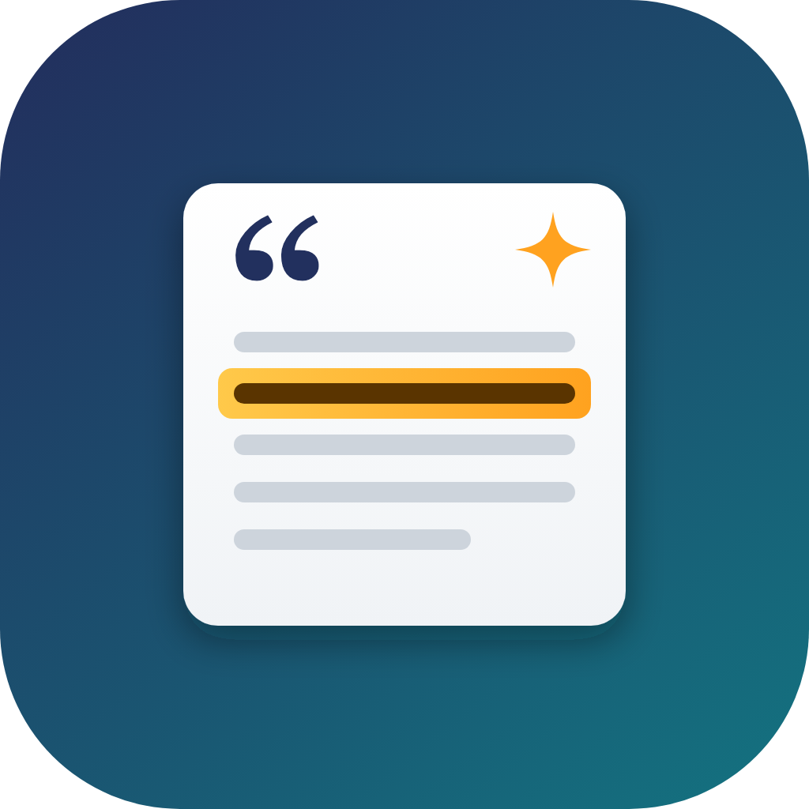
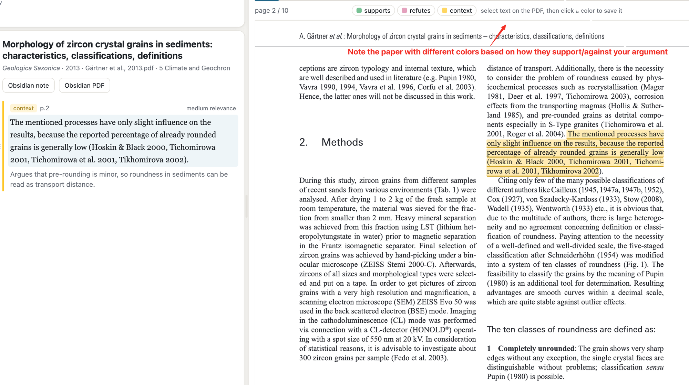
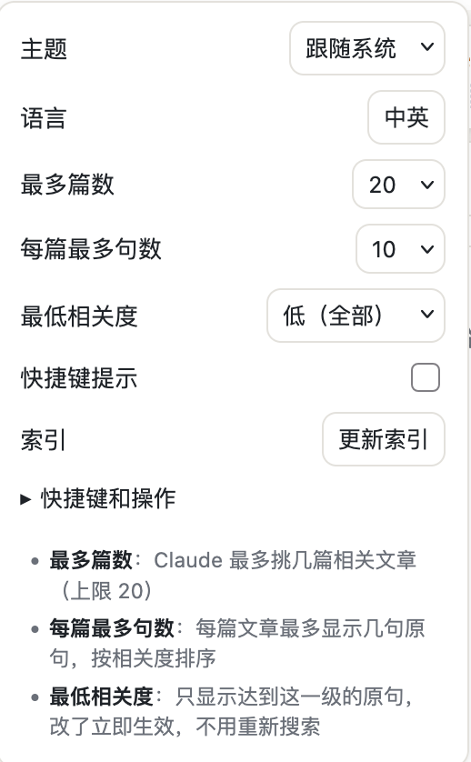

<div align="center">



# QuoteSight 有据可查

**从真实文献中找到支撑学术观点的那句话**

写给文献堆满硬盘、论点还没完全成形的研究者。


[](LICENSE)

[English](README.md) · **中文**

[开始前的选择](#开始前的选择) · [安装](#安装) · [使用](#使用) · [工作原理](#工作原理) · [体积与速度](#体积与速度) · [数据与隐私](#数据与隐私)

</div>

硬盘里存了几百篇文献，写引言或讨论时却还是抓耳挠腮：脑子里有一个模糊的论点，却不知道该去哪篇文献、哪一段、哪一句里找依据。用关键词搜，常常因为原文换了说法而搜不到；一篇篇打开 PDF 翻，又要花上好几个小时。

QuoteSight 先把你电脑上的 PDF 按关键词和意思建好索引，再让你常用的 AI agent（Claude Code 或 Codex）拿着你那个还不太清楚的论点去检索，把支持或反驳它的原句挑出来。每句原文都能在 PDF 原页上高亮打开，方便和原文对照。

https://github.com/user-attachments/assets/5e7a2aed-259a-4060-b3ab-354cf21326fa

- **从模糊的想法出发**：像平时说话那样写下论点，agent 会把它拆成几条具体的检索。
- **省 token**：文献库先建好了索引，agent 只读最相关的几十段，不用把整篇 PDF 读进去。一次完整的搜索，用的 token 往往比让 agent 读一篇长论文还少。
- **每句都能核对**：QuoteSight 把每句引文和 PDF 原文逐字比对，找不到的会被去掉，接近但不完全吻合的标为*未核验*。
- **文件留在本地**：索引存在你的电脑上，PDF 只读不改。只有精准搜索会把你的论点和挑出的段落发给 Anthropic 或 OpenAI。
- **安装简单**：运行一个安装脚本，回答四个问题，然后双击 *Start*。

## 开始前的选择

安装时会问四个问题，可以先想好：

| 问题 | 选项 | 拿不准就选 |
|---|---|---|
| **1. 你的系统** | macOS 或 Windows | 自动识别 |
| **2. 用哪个 coding agent** 做精准搜索 | Claude Code、Codex，或者不用 | 你平时在用的那个。不用的话，快速搜索照样能用 |
| **3. PDF 放在哪里** | 任意文件夹，包括子文件夹 | 你平时放文献的文件夹 |
| **4. 索引放在哪里** | 任意文件夹 | 默认位置（QuoteSight 文件夹里的 `data`）。不要放在 PDF 文件夹里，也不要放在云同步的文件夹里 |

需要大约 3 GB 硬盘空间（Python 依赖和 embedding 模型），索引每 100 篇文献约 30 MB。

## 安装

### macOS

1. **Python 3.10 或更新。** 在终端里运行 `python3 --version` 查看版本。版本太旧或者没有的话，从 [python.org](https://www.python.org/downloads/) 安装（或者运行 `brew install python`）。
2. **下载 QuoteSight。** 在终端里运行：
   ```sh
   git clone https://github.com/ZJ-Gao/QuoteSight.git
   cd QuoteSight
   ```
   也可以在 GitHub 页面点绿色的 *Code* 按钮下载 ZIP，解压后用 `cd` 进入这个文件夹。
3. **运行安装脚本**，回答四个问题：
   ```sh
   ./scripts/install.sh
   ```
4. **启动**：双击 QuoteSight 文件夹里的 `Start.command`。第一次运行会下载 embedding 模型（约 550 MB）并给你的 PDF 建索引，然后在浏览器里打开看板。之后再打开，只处理新增或改动过的 PDF。

> [!TIP]
> 如果 macOS 第一次拦下 `Start.command`，右键点它，选"打开"，再点一次"打开"。

### Windows

1. **Python 3.10 或更新。** 从 [python.org](https://www.python.org/downloads/windows/) 安装，安装时勾选 *Add python.exe to PATH*。
2. **下载 QuoteSight。** 在 GitHub 页面点绿色的 *Code* 按钮下载 ZIP 并解压，或者用 Git：
   ```powershell
   git clone https://github.com/ZJ-Gao/QuoteSight.git
   cd QuoteSight
   ```
3. **运行安装脚本**：在 QuoteSight 文件夹里打开 PowerShell，运行下面这行，然后回答四个问题：
   ```powershell
   powershell -ExecutionPolicy Bypass -File scripts\install.ps1
   ```
4. **启动**：双击 `Start.bat`。第一次运行会下载 embedding 模型并建索引，然后在浏览器里打开看板。

> [!TIP]
> 有 NVIDIA 显卡的话，在第 3 步之前先装好 CUDA 版的 PyTorch（[pytorch.org](https://pytorch.org/get-started/locally/)），建索引会快很多。没有的话就用处理器算，慢一些，但能用。

### Coding agent（可选）

要用精准搜索，先装好下面其中一个，并在终端里登录一次：
- **Claude Code**：见 [docs.anthropic.com/claude-code](https://docs.anthropic.com/en/docs/claude-code)，装好后运行一次 `claude` 登录。
- **Codex CLI**：见 [github.com/openai/codex](https://github.com/openai/codex)，装好后运行一次 `codex` 登录。

QuoteSight 直接用你现有的登录和订阅，不需要 API key。

想换成别的服务商（比如 Gemini、通过 Ollama 跑的本地模型，或者用 API key），把 [`prompts/add_model.md`](prompts/add_model.md) 的内容贴进你的 coding agent，它会加好新的后端并测试。如果只是在 Claude 或 Codex 的不同模型之间切换，改设置里的 `claude_model` 或 `codex_model` 就行。

### 让 agent 帮你安装

不想自己敲命令的话，在 QuoteSight 文件夹里打开 Claude Code 或 Codex，把 [`prompts/setup_with_ai.md`](prompts/setup_with_ai.md) 的内容贴进去。agent 每一步都会先问你：安装 QuoteSight、和你一起回答安装问题、建索引并测试。

## 使用

### 看板

双击 *Start*（或运行 `quotesight-app`），输入一个观点或话题，回车。看板分三栏：左栏是文章，中栏是选中文章里的原句，右栏是 PDF 页面，那句原文高亮显示。顶部状态栏显示模型、这次搜索用了多少 token，以及（Claude）5 小时和 7 天额度还剩多少。

在顶部选择搜索方式：
- **Claude** 或 **Codex**：精准，每次约一到两分钟。
- **快速**：不用 agent，约 1 到 2 秒，不花 token。由 embedding 模型标出最相关的句子，代替 agent 挑的原句。

### 为一个论点找证据

像说话一样输入你的论点，比如「锆石形态记录了搬运距离」。agent 会从几个角度检索你的文库；如果第一轮找到的文章少于你设的上限，它会换一批说法再搜一轮才停。它不会凑数：只有十二篇文章真正相关，你就得到十二篇。

左栏每篇文章显示它的句子和你论点的关系（*支持*、*反驳*或*背景*），以及一个满分 10 的相关度。这个分数综合两点：整篇文章和你的论点有多匹配，以及 agent 判断它的句子有多直接。点一篇文章，在中栏读它的原句；点一句，右栏的 PDF 上就高亮出来。每句原文都会和原文核对：找不到的会被去掉，接近但不完全吻合的标成 *unverified*。



### 觉得某篇该出现却没出现，或排得太低

- **看更多相关文章**（左栏底部）列出检索排名里接下来的文章，不花 token。对其中一篇点**加入结果**，agent 会读完整篇，挑出相关原句，并逐句标成支持、反驳或背景。这样加入的文章会保存在这次检索的历史里。
- **读更多句子**（中栏）让 agent 多读几句当前这篇。填一个数字，或留空让 agent 自己决定数量。
- **★ 比排名更重要**告诉看板：这篇比它现在的位置更重要。agent 会多读它几句，然后重新排名：和你标记的文章相似的文章会上移，每张卡片上的绿色或红色箭头显示它移动了几位。标记本身不会让它直接排第一。

### 标注你自己的高亮

在 PDF 页面上选中文字，点 PDF 上方的*支持*、*反驳*或*背景*（或选区旁弹出的菜单）。高亮按这个颜色保存，这样可以按每篇文章和你论点的关系做标记，之后能找回这段原文。不选文字时点一下颜色，可以改颜色和透明度。每行带行号的 accepted manuscript 也能正常高亮。

### 设置和历史

左上角的齿轮打开设置面板。



**最多篇数**和**每篇最多句数**限制一次搜索返回多少篇文章、每篇显示多少句。**最低相关度**隐藏低于所选级别的句子，不需要重新搜索。**语言**在英文和中英之间切换：中英模式下，界面、说明和总结是中文，原句保留英文。**更新索引**让索引和你的 PDF 文件夹保持一致。左上角的**历史**可以重新打开以前的搜索，不花 token，每条保持它当时的上限。拖动栏与栏之间的分隔线可以调宽度。

### 命令行

在 macOS 上，命令前面加 `.venv/bin/`（比如 `.venv/bin/quotesight-search`）；在 Windows 上加 `.venv\Scripts\`。

```sh
quotesight-search -t -p "turbidity currents triggered by river floods"     # 易读格式，按文章汇总
quotesight-search -c -n 8 "submarine fans during sea-level highstand"       # 紧凑格式，给 agent 用
quotesight-search --ask -t "hyperpycnal flows can feed deep-water fans"     # 用 agent 做精准搜索
quotesight update                                                      # 加入新增或改动的 PDF
```

| 命令 | 作用 |
|---|---|
| `quotesight setup` | 重新回答四个问题 |
| `quotesight update` | 处理新增或改动的 PDF，移除已删除的，查标题和作者 |
| `quotesight doctor` | 检查安装和配置 |
| `quotesight stats` / `errors` | 数量和体积；解析失败、扫描版和重复的 PDF |
| `quotesight-search [选项] "查询"` | `-p` 按文章汇总，`-t` 易读，`-c` 紧凑，`-n` 结果数，`-f` 主题文件夹，`--ask` 精准搜索 |
| `quotesight-app` | 打开看板 |

### 让你的 coding agent 来搜

安装向导最后会打印一段说明，里面有 `quotesight-search` 的完整路径。把它贴进 `CLAUDE.md`（Claude Code）或 `AGENTS.md`（Codex），或者用 [`prompts/agent_instructions.md`](prompts/agent_instructions.md) 里更完整的版本。之后你的 agent 会先搜索引，再决定开不开 PDF。读 10 段检索结果大约 5000 token，比直接读 PDF 少 10 到 50 倍，因为 PDF 的每一页都是以文字加图片的形式发给模型的。

## 工作原理

1. **提取文字**：用 [pdf-inspector](https://github.com/firecrawl/pdf-inspector) 把每个 PDF 按页转成 Markdown，它也能识别扫描页。每页切成约 300 词的段落，所以每段都知道自己在第几页。参考文献列表和目录不参与搜索。
2. **查重**：如果一个 PDF 一半以上的段落已经属于另一个 PDF，QuoteSight 只保存一份，并列出它的其他位置。
3. **两套索引**：关键词索引（SQLite FTS5，BM25 排序）负责精确的名称和术语；语义索引用 [nomic-embed-text-v1.5](https://huggingface.co/nomic-ai/nomic-embed-text-v1.5) 生成的向量，负责找到换了说法但意思相同的段落。embedding 模型在你的电脑上运行，可以用 Apple 芯片、NVIDIA 显卡或处理器。
4. **检索**：一个查询同时走两套索引，两个排名用 reciprocal rank fusion 合并。文章旁边的百分比是它在这次结果里的相对分数，用来比较文章，不是概率。
5. **标题和作者**：QuoteSight 从前两页找到 DOI，去 [Crossref](https://www.crossref.org/) 查询，只有查回来的标题能在 PDF 里找到才采用。查不到时，用文件名。
6. **精准搜索**：coding agent 把你的输入拆成 2 到 4 条具体的查询。QuoteSight 连同你的原话一起检索，再把整体上排名靠前的每篇文章最相关的一段也补进去，一并交给 agent。agent 挑出原句，每句标上立场、相关度并写一句说明。如果这些句子涉及的文章少于你设的上限，agent 会换个角度写几条新查询，QuoteSight 再读一轮。agent 只拿到文字，没有任何工具，也不能读写文件。提示词是 `quotesight/prompts/` 里的 Markdown 文件，可以按你的领域修改。
7. **核验**：QuoteSight 把每句和原段落比对，允许文字提取时插进句子中间的脚注或分栏。agent 把句子挂在错误段落上时，会在文库里找到它并改挂到正确的段落；哪里都找不到的会被去掉，接近但不完全吻合的标为*未核验*。
8. **分数和排名**：每篇文章最多有三个 0 到 1 的分数，满分 10 的相关度是它们的平均乘 10：整篇文章和输入、各条查询的匹配程度；agent 对它的句子的相关度判断；以及你标记文章之后，按被标记文章调整的相似度（Rocchio 相关反馈，计算时不用文章自己的句子，所以标记不会自己把它抬上去）。这些都在你的电脑上用索引算出，不花 token。
9. **高亮**：[pdf.js](https://mozilla.github.io/pdf.js/) 渲染页面的文字层，原句在文字层里逐字定位，所以高亮可以从一行的中间开始、在中间结束。accepted manuscript 的行号会夹在文字层的单词之间，第一次匹配失败时，看板会忽略数字再匹配一次。有些老 PDF 的字体编码会让文字层变成乱码，这时看板会提示这一页没法高亮。

## 设置

安装向导把 `config.toml` 写到 `~/.config/quotesight/`（macOS）或 `%APPDATA%\quotesight\`（Windows）。重新运行 `quotesight setup` 可以修改主要选项，也可以直接编辑这个文件，[`config.example.toml`](config.example.toml) 里有每个选项的说明。最可能要改的几项：

- **主题文件夹**：PDF 文件夹下的第一层子文件夹会成为可以筛选的主题。`topic_pattern` 可以只索引名字符合规则的文件夹。
- **Agent 的模型和 effort**：`claude_model`、`claude_effort`、`codex_model`、`codex_effort`（默认 Sonnet，medium）。
- **文献库描述**：一句话说明你的领域，会写进给 agent 的提示词。

QuoteSight 不接入笔记软件。如果想从结果直接打开自己的笔记（比如 Obsidian），可以让你的 coding agent 加一个按钮；看板只有一个文件，`quotesight/static/index.html`。

## 体积与速度

在一台 Apple 芯片的 MacBook 上，用 565 篇 PDF（4.8 GB）测得：

| 步骤 | 结果 |
|---|---|
| 提取文字 | 565 篇共约 50 秒 |
| 生成向量（第一次） | 约 48 分钟；之后每篇新 PDF 几秒 |
| 索引体积 | 约 3.1 万段，约 160 MB |
| 搜索 | 看板里不到 0.1 秒；快速模式加上标句子约 1 到 2 秒；命令行约 6 秒，主要花在加载模型 |
| 精准搜索 | 约一到两分钟 |

## 数据与隐私

- **本地**：PDF 和索引只存在你的电脑上，看板也只有你的电脑能访问（`127.0.0.1`）。
- **Crossref** 只收到 DOI 和简短的标题文字；只有你在设置里填了邮箱，才会附上邮箱。
- **精准搜索**会把你的输入和挑出的段落发给 Anthropic 或 OpenAI，按你账户的条款处理。快速搜索什么都不发送。
- **数据文件夹**（你选的索引位置）：`index.sqlite` 是索引，`history/` 里是每次精准搜索的结果。删掉这个文件夹就能从头开始。

## 常见问题

- **`'NomicBertModel' object has no attribute 'get_extended_attention_mask'`**：装上了更新版本的 `transformers`。运行 `.venv/bin/pip install "transformers==4.48.3" "sentence-transformers==3.4.1"`（Windows 用 `.venv\Scripts\pip`）。
- **搜不到某篇 PDF**：`quotesight errors` 会列出扫描版（没有文字层）和读取失败的 PDF。
- **找不到 `claude` 或 `codex`**：先安装，在终端里登录一次，再运行 `quotesight doctor`。
- **看板打不开**：可能有别的程序占用了 8765 端口，运行 `quotesight-app --port 8780`。

## 致谢

| 项目 | 用途 | 许可 |
|---|---|---|
| [pdf-inspector](https://github.com/firecrawl/pdf-inspector)（Firecrawl） | PDF 文字提取和扫描页识别，索引里的全部文字都来自它 | MIT |
| [nomic-embed-text-v1.5](https://huggingface.co/nomic-ai/nomic-embed-text-v1.5)（Nomic AI） | embedding 模型 | Apache 2.0 |
| [sentence-transformers](https://github.com/UKPLab/sentence-transformers) | 运行 embedding 模型 | Apache 2.0 |
| [SQLite FTS5](https://www.sqlite.org/fts5.html) | 关键词索引 | 公有领域 |
| [pdf.js](https://github.com/mozilla/pdf.js)（Mozilla） | 渲染 PDF，提供高亮用的文字层 | Apache 2.0 |
| [Crossref REST API](https://www.crossref.org/documentation/retrieve-metadata/rest-api/) | 标题、作者、期刊、DOI | 开放元数据 |
| [FastAPI](https://github.com/fastapi/fastapi) 和 [Uvicorn](https://github.com/encode/uvicorn) | 本地网页服务 | MIT、BSD |
| [Claude Code](https://docs.anthropic.com/en/docs/claude-code) 和 [Codex CLI](https://github.com/openai/codex) | 可选的精准搜索 | 各自的条款 |

原句和 PDF 文字层的逐字对齐，参考了 Obsidian 插件 [PDF++](https://github.com/RyotaUshio/obsidian-pdf-plus) 的选区链接做法。

## 许可证

本项目以 [MIT 许可证](LICENSE) 开源，© 2026 ZJ-Gao。上面用到的模型和第三方库各有自己的许可。
